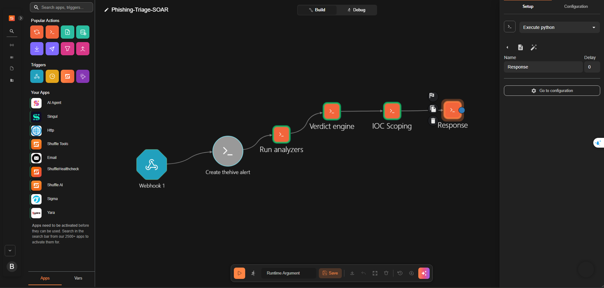

# Phishing Triage SOAR Lab

Hệ thống tự động phân tích và xử lý email phishing do người dùng báo cáo, xây dựng trên
**Wazuh + Shuffle + TheHive + Cortex** và một Telegram bot phân tích email.

Người dùng chuyển tiếp email đáng ngờ cho bot; pipeline trích xuất IOC, làm giàu dữ liệu
(threat intelligence), chấm điểm có giải thích và phân loại. Alert được tạo trong TheHive;
node xử lý cuối tạo case khi verdict là `MALICIOUS`. Hiện node này chưa tự áp case template,
nên các task từ template không được thêm tự động vào case.

> Đây là project lab/portfolio. Email mẫu dùng dữ liệu giả lập, nhưng một số URL/domain/IP
> trong nội dung có thể là địa chỉ thật. Không mở link hoặc chạy tệp đính kèm.

## Demo

[Xem video demo trên Google Drive](https://drive.google.com/file/d/18XYGPXLBNor5nYs_-_VrE7KSP1fa0uHg/view?usp=sharing)

## Kiến trúc



```
Telegram bot (.eml)                          Người dùng báo cáo email
      │  phân tích, ghi log JSON
      ▼
Wazuh agent ──► Wazuh manager                SIEM: rule 100511/100512, gắn MITRE T1566
      │  webhook (chỉ verdict PHISHING/SUSPICIOUS)
      ▼
Shuffle (SOAR) ── 5 node Python
   1. Create alert     tạo alert TheHive, observable + sourceRef chống trùng
   2. Run analyzers    chạy analyzer qua Cortex (VirusTotal, AbuseIPDB, urlscan, Abuse_Finder)
   3. Verdict engine   chấm điểm (dấu hiệu bot + threat intel + RDAP), ra verdict + category
      4. IOC scoping      truy vấn Wazuh Indexer để tìm DNS hit của domain trong alert
      5. Respond          cập nhật scoping; MALICIOUS→tạo case | SUSPICIOUS→analyst | CLEAN→đóng
      │
      ▼
TheHive + Cortex                             Case management + enrichment engine
```

## Thành phần

| Thành phần | Vai trò |
|-----------|---------|
| Telegram phishing bot | Nhận email `.eml`, parse header/URL/đính kèm, chấm điểm sơ bộ, ghi log JSON |
| **Wazuh** | Thu log của bot, phân mức độ bằng rule, chuyển alert sang Shuffle |
| **Shuffle** | Điều phối: tạo alert, chạy enrichment, chấm điểm, xử lý theo verdict |
| **Cortex** | Chạy analyzer threat intelligence trên từng observable |
| **TheHive** | Quản lý alert/case, lưu bằng chứng, case template, dashboard |

## Cách chấm điểm & phân loại

Verdict engine tính điểm **mới** (không cộng dồn điểm sơ bộ của bot) từ ba nguồn, mỗi điểm kèm lý do:

- **Dấu hiệu từ bot**: SPF/DKIM/DMARC fail, header mismatch, yêu cầu đăng nhập, ngôn ngữ khẩn cấp,
  mạo danh thương hiệu, dự đoán của mô hình AI.
- **Threat intelligence** (qua Cortex): số engine VirusTotal gắn cờ, điểm AbuseIPDB, kết quả urlscan.
- **Tuổi domain (RDAP)**: domain mới đăng ký hoặc không tồn tại → cộng điểm.

**Verdict**: `MALICIOUS` (≥70) · `SUSPICIOUS` (≥40) · `INCONCLUSIVE` (điểm thấp nhưng thiếu bằng chứng) · `CLEAN`
**Category**: `credential_phishing` · `malware` · `bec` · `spam_or_legit`

Phân loại hai chiều giúp bắt được cả **BEC** — loại không có URL/file nên điểm thấp, dễ bị bỏ sót nếu
chỉ chấm điểm thuần.

## Cấu trúc repo

```
shuffle/                 5 node Python của workflow (chạy trong Shuffle > Execute Python)
wazuh/                   rule + tích hợp webhook + snippet localfile
thehive/case-templates/  3 case template (có thể import và áp dụng thủ công trong TheHive)
tests/sample-emails/     5 email mẫu để test từng nhánh
docs/images/             ảnh chụp workflow và TheHive
.env.example             danh sách tham khảo các giá trị cần cấu hình
```

## Triển khai (tóm tắt)

Yêu cầu: Wazuh, một Shuffle (cloud hoặc self-host), TheHive 5 + Cortex đã kết nối, một Telegram bot phân tích email.

1. **Bot**: ghi log JSON tại `/var/log/phishing-bot/events.jsonl` (xem các trường trong `shuffle/1_create_thehive_alert.py`).
2. **Wazuh**: thêm `wazuh/local_rules.xml`; thêm `localfile-snippet.xml` vào agent; thêm `ossec-integration.xml` vào manager (điền webhook Shuffle).
3. **Cortex**: bật analyzer `VirusTotal_GetReport`, `AbuseIPDB`, `Urlscan_io_Search`, `Abuse_Finder` (nhập API key).
4. **TheHive**: kết nối Cortex; tạo tài khoản dịch vụ cho Shuffle (profile analyst) và lấy API key. Có thể import 3 case template để analyst áp dụng thủ công; workflow hiện chưa gắn template khi tự tạo case.
5. **Shuffle**: tạo workflow Webhook → 5 node theo thứ tự trong sơ đồ, dán code từ `shuffle/` và cấu hình URL/credential theo môi trường triển khai.
      `.env.example` chỉ liệt kê các giá trị tham khảo; các script hiện không tự đọc file `.env` và một số biến cấu hình đang để rỗng.
6. **Test**: gửi từng email trong `tests/sample-emails/` cho bot, xem alert/case trong TheHive.

## Bảo mật

- Không commit secret: API key, token, webhook URL hoặc thông tin truy cập. `.env` được `.gitignore`, nhưng các script không tự nạp file này.
- Email mẫu có thể chứa URL/domain/IP thật; chỉ xử lý trong lab và không mở URL hoặc tệp đính kèm.

## Ảnh minh hoạ

Ảnh hiện có trong `docs/images/`:
- `01_shuffle_workflow.png`
- `theHive.png`
- `theHive_alert.png`
- `theHive_case_detail.png`
- `theHive_case_detail_2.png`

## License

MIT — xem [LICENSE](LICENSE).
